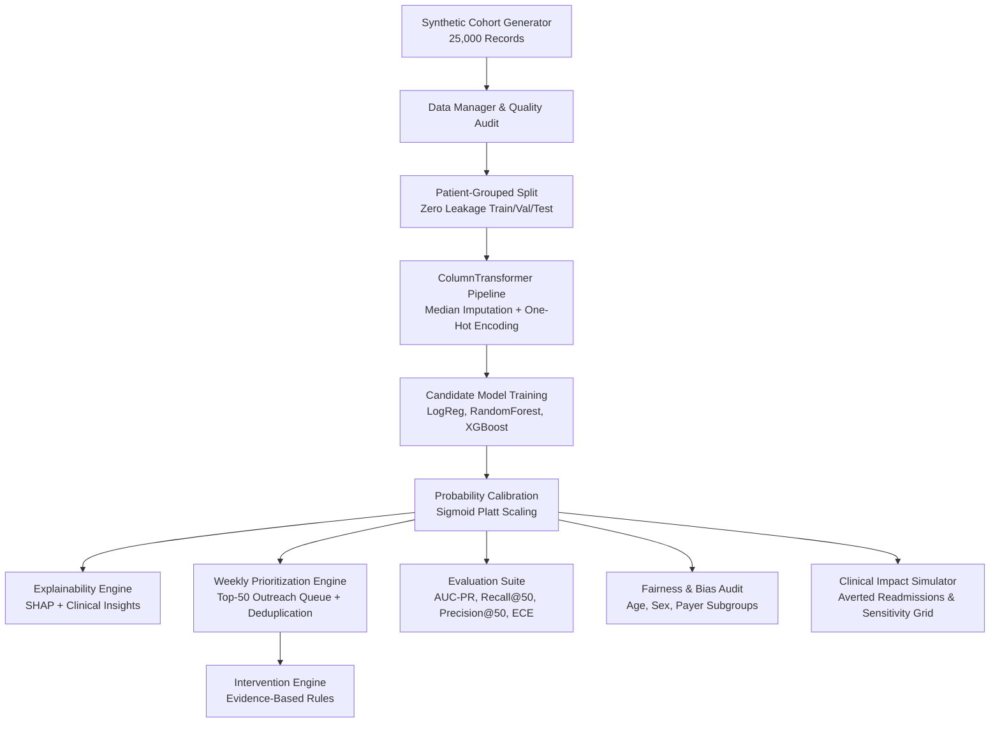

# CarePulse AI
### 30-Day Hospital Readmission Prediction & Smart Intervention Platform
> *"Predict Earlier. Care Smarter. Prevent Readmissions."*

[](https://www.python.org/)
[](https://streamlit.io/)
[](LICENSE)
[](tests/)

---

## 1. Executive Summary

**CarePulse AI** is a clinical decision-support and care-coordination platform designed for hospital transitions-of-care teams. 

In clinical operations, care-management teams face a critical resource bottleneck: while hundreds to thousands of patients are discharged every month, care teams have a finite weekly outreach capacity—typically **50 patients per week**—for post-discharge telephonic follow-up, home health evaluations, and clinical pharmacist medication reconciliation.

CarePulse AI bridges this operational gap by:
1. **Predicting Calibrated 30-Day Readmission Risk**: Employs probability-calibrated machine learning (Platt scaling / Sigmoid) with zero patient-leakage grouped partitioning.
2. **Prioritizing Monday Morning Call Lists**: Automatically filters out ineligible discharge dispositions (e.g., Expired, Hospice, AMA), deduplicates repeat encounters per patient, and ranks patients by clinical priority within the 50-patient weekly constraint.
3. **Translating ML Attributions into Clinical Narratives**: Leverages Explainable AI (SHAP) to convert mathematical feature contributions into plain-language clinical risk drivers.
4. **Recommending Interpretable Care Pathways**: Evaluates rule-based clinical criteria to suggest targeted interventions (e.g., Medication Reconciliation, Rapid Care Access, Nurse Coordination).
5. **Auditing Fairness & Algorithmic Parity**: Transparently audits model performance, calibration, and outreach allocation across demographic subgroups (Age, Sex, and Payer Type).
6. **Simulating Population Health Impact**: Models hypothetical readmissions averted under user-configurable outreach adherence and relative risk reduction (RRR) assumptions.

---

## 2. Visual Design System

CarePulse AI incorporates a purpose-built clinical SaaS aesthetic:

| Token | Hex Code | Clinical Application |
|---|---|---|
| **Deep Navy** | `#142D4E` | Sidebar background, primary brand typography |
| **Midnight Blue** | `#1B3B5F` | Secondary navigation structure, clinical dividers |
| **Primary Teal** | `#16A6A1` | Primary call-to-actions, active state indicators |
| **Deep Teal** | `#117C78` | Secondary action buttons, badge accents |
| **Soft Mint** | `#DDF5EC` | Low-risk status badges, success indicators |
| **Pale Blue** | `#EAF3FC` | Moderate-risk status badges, information callouts |
| **Warm Off-White** | `#F7F9FC` | Dashboard canvas background |
| **Pure White** | `#FFFFFF` | Elevated clinical cards, metric containers |
| **Main Text** | `#253449` | High-contrast clinical typography |
| **Secondary Text** | `#738197` | Supporting metadata, captions, clinical units |
| **Warning Amber** | `#F2B84B` | High-risk alerts, polypharmacy warnings |
| **Critical Red** | `#D95362` | Very high-risk indicators, urgent clinician review flags |
| **Border** | `#E3EAF1` | Standard card and table borders |

---

## 3. Technology Stack

- **Runtime Environment**: Python 3.10 to 3.14 (fully cross-platform: Linux, macOS, Windows)
- **Application Framework**: Streamlit 1.60+
- **Data Engineering**: Pandas, NumPy, SciPy
- **Machine Learning**: Scikit-Learn (Pipelines, GroupShuffleSplit, CalibratedClassifierCV)
- **Gradient Boosting**: XGBoost, LightGBM, HistGradientBoostingClassifier (with automatic graceful fallback)
- **Model Explainability**: SHAP (TreeExplainer and LinearExplainer with heuristic attribution fallback)
- **Visual Analytics**: Plotly Express & Plotly Graph Objects
- **Model Serialization**: Joblib
- **Testing & Verification**: Pytest

---

## 4. Architecture & Data Workflow



---

## 5. Repository Structure

```text
carepulse-ai/
├── .gitignore                      # Production Git ignore rules
├── .streamlit/
│   └── config.toml                 # Streamlit theme and server configuration
├── README.md                       # Comprehensive project documentation
├── requirements.txt                # Production Python dependencies
├── app.py                          # Streamlit application entry point
├── evaluate.py                     # Standalone CLI model evaluation script
├── data/
│   └── synthetic_discharge_records.csv  # 25,000-record synthetic demonstration cohort
├── models/
│   └── carepulse_model_bundle.joblib    # Pre-trained and calibrated model bundle (~9 KB)
├── reports/
│   ├── calibration_bins.csv        # 10-bin calibration reliability statistics
│   ├── evaluation_metrics.csv      # Test cohort performance metrics
│   └── evaluation_summary.json     # Machine-readable evaluation report
├── src/
│   ├── __init__.py                 # Package initializer
│   ├── config.py                   # Design tokens, risk bands, schema specifications
│   ├── data_generator.py           # Probabilistic synthetic cohort generator
│   ├── data_manager.py             # Data ingestion, schema audit, and deduplication
│   ├── preprocessor.py             # Grouped train/test splits and preprocessing pipelines
│   ├── models.py                   # Multi-model training, model selection, calibration
│   ├── explainer.py                # SHAP attributions and clinical narrative generation
│   ├── intervention_engine.py      # Evidence-based care pathway recommendations
│   ├── call_list.py                # Capacity-constrained call list & supervisor overrides
│   ├── evaluator.py                # Clinical decision support metrics (AUC-PR, Recall@K)
│   ├── fairness.py                 # Algorithmic bias and demographic parity audits
│   ├── simulator.py                # Population health impact and sensitivity modeling
│   └── ui_components.py            # Clinical design system and custom styling
└── tests/
    ├── test_call_list_capacity.py   # Capacity constraint & eligibility tests
    ├── test_data_validation.py      # Schema and data cleanliness tests
    ├── test_exports.py              # Call list CSV export tests
    ├── test_fairness_audit.py       # Demographic subgroup parity tests
    ├── test_intervention_engine.py  # Clinical recommendation rule tests
    ├── test_metrics_recall50.py     # Recall@50 and ECE calculation tests
    ├── test_models_calibration.py   # Probability calibration tests
    └── test_preprocessor.py         # Leakage prevention and grouped split tests
```

---

## 6. Local Setup & Execution Guide (Windows PowerShell)

Follow these steps to set up and run the application locally:

### Step 1: Open PowerShell and Navigate to Project Directory
```powershell
cd "c:\Users\dunea\OneDrive\Desktop\lalitha team"
```

### Step 2: Create and Activate Virtual Environment (Recommended)
```powershell
# Create a dedicated virtual environment named .venv
python -m venv .venv

# Activate the virtual environment
.\.venv\Scripts\Activate.ps1
```
*(Note: If PowerShell execution policy restricts scripts, run `Set-ExecutionPolicy -Scope Process -ExecutionPolicy Bypass` first).*

### Step 3: Install Required Dependencies
```powershell
pip install -r requirements.txt
```

### Step 4: Run Automated Tests
Execute the comprehensive automated test suite to ensure all clinical modules and calibration routines are verified:
```powershell
python -m pytest tests/ -v
```
*Expected result: 16 passed tests.*

### Step 5: (Optional) Run CLI Model Evaluation
Run standalone model training and test-split evaluation:
```powershell
python evaluate.py
```

### Step 6: Launch the Streamlit Web Application
```powershell
python -m streamlit run app.py
```
The application will launch and open in your default browser at `http://localhost:8501`.

---

## 7. Streamlit Community Cloud Deployment Guide

This project is pre-configured for direct, zero-configuration deployment on **Streamlit Community Cloud**:

### Deployment Steps:
1. **Push your code to GitHub** (see Git instructions below).
2. Go to [share.streamlit.io](https://share.streamlit.io/) and log in with your GitHub account.
3. Click **"Create app"** (or **"New app"**).
4. Fill in the repository settings:
   - **Repository**: `your-username/carepulse-ai` (select your repository)
   - **Branch**: `main`
   - **Main file path**: `app.py`
5. Click **"Advanced settings"** (optional):
   - **Python version**: Select `3.11` or `3.12` (recommended).
   - **Secrets**: None required for standard operation (CarePulse AI operates self-contained without external API keys).
6. Click **"Deploy!"**.
7. Streamlit Community Cloud will automatically install dependencies from `requirements.txt`, apply theme settings from `.streamlit/config.toml`, and launch the live web app.

---

## 8. Git Version Control Instructions

To initialize the repository, review files, create the initial commit, and link to GitHub:

### Step 1: Initialize Git Repository (if not already initialized)
```powershell
git init -b main
```

### Step 2: Review Files to be Tracked
```powershell
# Review git status to ensure .gitignore properly filters caches and temporary logs
git status
```

### Step 3: Stage Files for Commit
```powershell
git add .
```

### Step 4: Create Initial Commit
```powershell
git commit -m "feat: initial commit for CarePulse AI deployment on Streamlit Community Cloud"
```

### Step 5: Create a Remote Repository on GitHub
1. Open your web browser and navigate to [https://github.com/new](https://github.com/new).
2. Name the repository (e.g., `carepulse-ai`).
3. Set the repository visibility (Public or Private).
4. **Do not** check "Add a README file", "Add .gitignore", or "Choose a license" (these are already configured in this repository).
5. Click **"Create repository"**.

### Step 6: Link Remote and Push to GitHub
Copy your repository URL from GitHub and run:
```powershell
# Add remote origin (replace YOUR_USERNAME and YOUR_REPO with your GitHub details)
git remote add origin https://github.com/YOUR_USERNAME/YOUR_REPO.git

# Verify remote configuration
git remote -v

# Push to GitHub main branch
git push -u origin main
```
*(If GitHub prompts for authentication, authenticate securely via GitHub CLI `gh auth login`, the Git Credential Manager browser sign-in modal, or an SSH key. Never paste passwords directly into chat).*

---

## 9. Data, Model Initialization & Privacy Guarantees

- **Automatic Self-Healing**: If `data/synthetic_discharge_records.csv` or `models/carepulse_model_bundle.joblib` are absent, the application automatically initializes the demo cohort (25,000 synthetic encounters) and fits a calibrated model on the fly during container cold start.
- **Data Privacy & Compliance**: 
  - All data contained in this repository is 100% synthetically generated and HIPAA-safe.
  - No Protected Health Information (PHI) or real human subject records are stored.
  - The deterministic demonstration phone numbers generated by the call list engine use the reserved `(555)` test exchange.
  - Operational logs (`reports/call_list_overrides.json`, `reports/contact_outcomes.json`) and exported call lists are excluded by `.gitignore` to prevent committing user-entered clinical notes.

---

## 10. Clinical & Ethical Disclaimers

1. **Demonstration & Research Prototype**: CarePulse AI is designed for educational demonstrations, algorithmic fairness audits, and healthcare operations research.
2. **Synthetic Cohort**: All patient demographics, clinical diagnostic codes, and laboratory values are synthetically generated.
3. **Statistical Correlation vs. Causation**: Risk factors identified by the model indicate statistical associations with 30-day readmissions and do not represent verified causal medical mechanisms.
4. **Decision Support Only**: CarePulse AI is an operational triage aid and does not constitute medical advice or replace professional clinical judgment.
"# Healix" 
